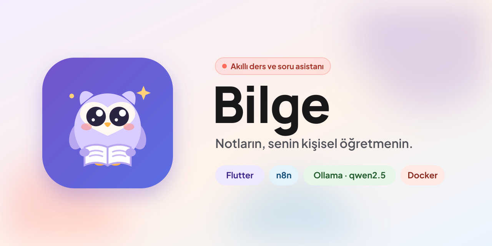
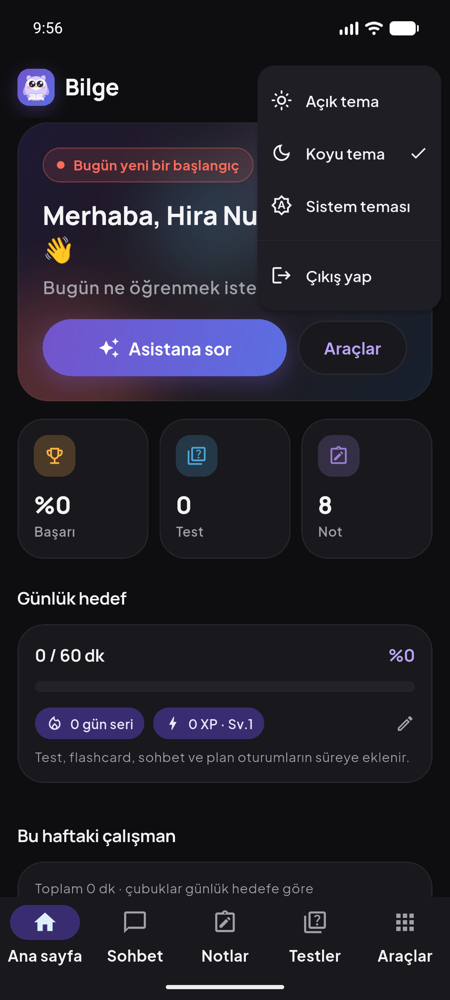
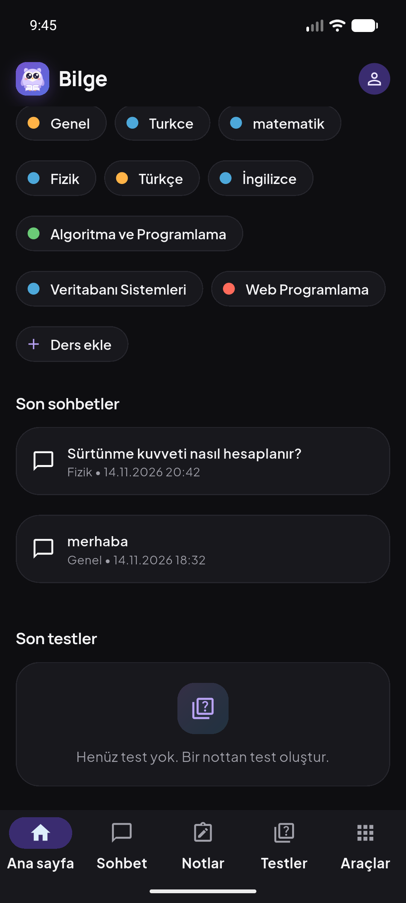
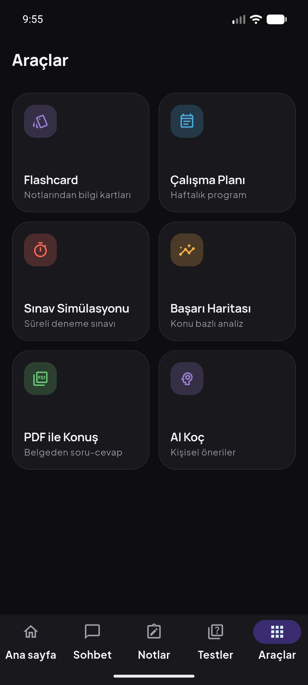
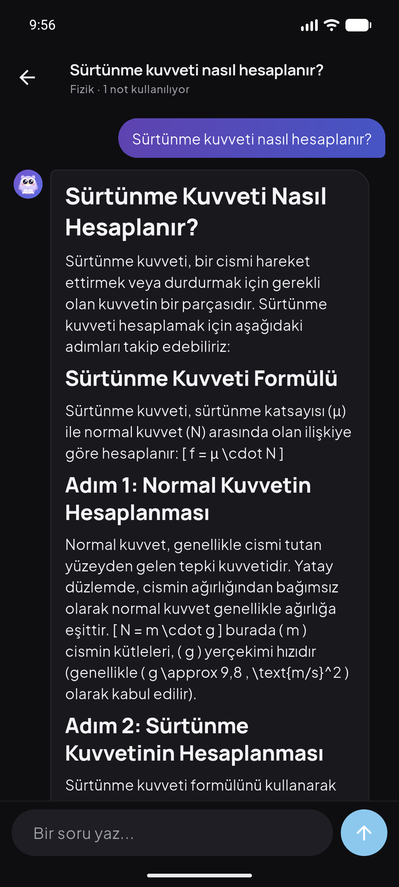
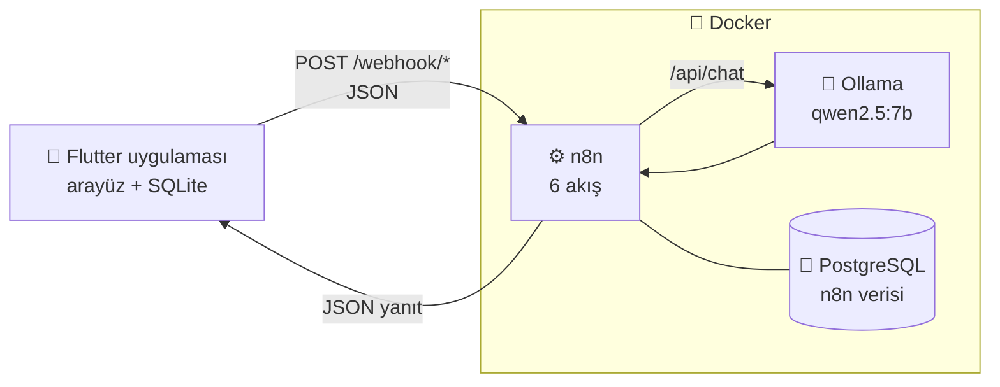

<div align="center">



<br>


**Notların, senin kişisel öğretmenin.**
Ders notlarından özet, test ve bilgi kartı üreten; soruları dersin bağlamında yanıtlayan ve çalışmanı takip eden yapay zekâ destekli mobil uygulama.

[Özellikler](#-özellikler) · [Ekran görüntüleri](#-ekran-görüntüleri) · [Mimari](#-mimari) · [n8n akışları](#-n8n-akışları) · [Kurulum](#-kurulum) · [Proje yapısı](#-proje-yapısı)

</div>

---

## 🦉 Bilge nedir?

Öğrenciler notlarıyla baş başa kalıyor: özet çıkarmak zaman alıyor, hangi konuda eksik olduklarını bilmiyorlar ve çalışmalarını planlayan kimse yok. **Bilge**, öğrencinin kendi ders notlarını kişisel bir öğretmene dönüştürür.

Yapay zekâ modeli **bilgisayarda yerel olarak** (Ollama) çalışır: notlar üçüncü taraf bir servise gönderilmez, API ücreti yoktur.

## ✨ Özellikler

| | Özellik | Açıklama |
|---|---|---|
| 💬 | **Dersi bilen sohbet** | Her soruya ders bilgisi, ilgili not parçaları ve son 6 mesaj eklenir; devam soruları anlaşılır. |
| 📝 | **Not özeti** | Notu kısa bir özete ve anahtar noktalara dönüştürür. |
| ❓ | **Test oluşturma** | Nottan 5 çoktan seçmeli soru üretir, her soruyu doğrular. |
| 📊 | **Performans analizi** | Puanı hesaplar, eksik konuları bulur, kişisel çalışma önerisi yazar. |
| 🃏 | **Flashcard** | Nottan bilgi kartları üretir; Leitner sistemiyle tekrar zamanlar. |
| ⏱️ | **Sınav simülasyonu** | Seçilen notlardan süreli deneme; süre bitince otomatik teslim. |
| 🗺️ | **Başarı haritası** | Ders bazlı başarı, en çok zorlanılan konular, son 10 test grafiği. |
| 📅 | **Çalışma planı** | Başarısı düşük derslere daha çok oturum ayıran haftalık program. |
| 📄 | **PDF ile konuş** | PDF metnini okur, soruları belgeye dayanarak yanıtlar. |
| 🧭 | **AI koç** | Tüm verilere bakıp "Bugün yap / Bu hafta yap" önerileri verir. |
| 🔥 | **Çalışma takibi** | Günlük hedef, seri, haftalık grafik ve XP; süre otomatik kaydedilir. |
| 🌗 | **Açık / koyu tema** | Pastel tasarım dili, gömülü yazı tipleri. |

## 📱 Ekran görüntüleri

<div align="center">

| Giriş | Ana sayfa | Araçlar | Sohbet |
|:---:|:---:|:---:|:---:|
|  |  |  |  |

</div>

## 🏗️ Mimari



- Uygulama yapay zekâya **doğrudan bağlanmaz**; tüm istekler n8n üzerinden geçer. Model ya da kurallar değişse bile uygulamayı yeniden derlemek gerekmez.
- Öğrenci verileri (notlar, testler, sonuçlar, flashcard, çalışma kaydı) **telefondaki SQLite** veritabanında tutulur; her sorgu kullanıcı kimliğiyle filtrelenir, şifreler SHA-256 ile özetlenerek saklanır.

## ⚙️ n8n akışları

Altı akışın hepsi aynı yapıyı izler:

```
Uygulamadan İstek → İsteği Doğrula → Geçerli mi? → Ollama → Yanıtı İşle → Uygulamaya Yanıt
                                         └──────────── Hata yolu → { success: false, error } ─┘
```

| Akış | Adres | Görev |
|---|---|---|
| `01 · AI Sohbet` | `POST /webhook/chat` | Sohbet, AI Koç ve PDF sorularını yanıtlar |
| `02 · Ders Notu Özeti` | `POST /webhook/ozet` | Notu kısa özet ve anahtar noktalar olarak özetler |
| `03 · Test Oluşturma` | `POST /webhook/test-olustur` | Nottan 5 çoktan seçmeli soru üretir ve doğrular |
| `04 · Performans Analizi` | `POST /webhook/performans` | Puanı kodla hesaplar, öneriyi modele yazdırır |
| `05 · Flashcard Üretimi` | `POST /webhook/flashcard-olustur` | Nottan 3–25 bilgi kartı üretir |
| `06 · Sağlık Kontrolü` | `GET /webhook/saglik` | n8n, Ollama ve modelin çalıştığını gösterir |

Akış dosyaları [`n8n-workflows/`](n8n-workflows) klasöründedir; her akışın üstünde ne işe yaradığını anlatan bir not bulunur. Örnek istek gövdeleri [`docs/ornek-istekler/`](docs/ornek-istekler) içindedir.

## 🧰 Teknolojiler

| Katman | Teknoloji |
|---|---|
| Mobil | Flutter (Material 3), sqflite, shared_preferences, flutter_markdown_plus, file_picker, syncfusion_flutter_pdf |
| Otomasyon | n8n (Webhook, Code, IF, HTTP Request, Respond to Webhook) |
| Yapay zekâ | Ollama · `qwen2.5:7b` (yerel, 8.192 token bağlam) |
| Altyapı | Docker Compose · PostgreSQL 16 |
| Tasarım | Manrope + Plus Jakarta Sans · pastel palet · özgün baykuş logosu |

## 🚀 Kurulum

**Gereksinimler:** Docker Desktop, Flutter SDK, Android Studio (emülatör). Ollama konteyneri NVIDIA GPU ile hızlı çalışır.

```powershell
# 1. Depoyu indir
git clone https://github.com/hirakarakuzu/akilli-ders-asistani.git
cd akilli-ders-asistani

# 2. Ortam değişkenlerini hazırla (.env içindeki şifreleri değiştir)
copy .env.example .env

# 3. Servisleri başlat ve modeli indir
docker compose up -d
docker exec ollama ollama pull qwen2.5:7b

# 4. n8n akışlarını yükle ve etkinleştir
powershell -ExecutionPolicy Bypass -File .\import-workflows.ps1

# 5. Uygulamayı çalıştır
cd mobile
flutter pub get
flutter run
```

Kurulumu kontrol etmek için tarayıcıda **http://localhost:5678/webhook/saglik** adresini aç; `"model_yuklu": true` görmelisin.

> Android emülatörü bilgisayara `10.0.2.2` üzerinden bağlanır. Gerçek telefonda:
> `flutter run --dart-define=N8N_URL=http://BILGISAYAR_IP:5678`

## 📁 Proje yapısı

```
akilli-ders-asistani/
├── docker-compose.yml          # n8n + Ollama + PostgreSQL
├── import-workflows.ps1        # akışları temizler, yükler, yayınlar
├── n8n-workflows/              # 6 n8n akışı
├── scripts/                    # veritabanı temizliği, ekran görüntüsü
├── docs/                       # görseller, ekran görüntüleri, örnek istekler
└── mobile/                     # Flutter uygulaması
    ├── assets/                 # yazı tipleri, logo
    └── lib/
        ├── core/               # tema, ortak bileşenler, yardımcılar
        ├── features/           # flashcard, sınav, plan, başarı haritası, PDF, AI koç
        ├── screens/            # giriş, ana sayfa, sohbet, notlar, testler
        ├── api.dart            # n8n istemcisi
        └── db.dart             # SQLite
```

## 🎨 Tasarım

Bilge, [Lezzet Atlası](https://hirakarakuzu.github.io/lezzet-atlasi/) ile aynı pastel renk ailesini kullanır; ana rengi lavantadan maviye geçen bir tondur.

| Lavanta | Gök mavisi | Mercan | Kehribar | Adaçayı |
|:---:|:---:|:---:|:---:|:---:|
| `#9B7FD4` | `#4DA8DA` | `#FF6B5B` | `#FFB347` | `#6BCB77` |

## 🛣️ Yol haritası

- [x] Dersi bilen sohbet, özet, test ve performans analizi
- [x] Flashcard, sınav simülasyonu, çalışma planı, başarı haritası, PDF ile konuş, AI koç
- [x] Çalışma takibi (hedef, seri, haftalık grafik)
- [x] Yeni tasarım ve logo
- [ ] Bulut senkronizasyonu
- [ ] Çalışma hatırlatma bildirimleri
- [ ] Gerçek cihazlarda test
- [ ] Sesli soru sorma

## 👩‍💻 Geliştirici

**Hira Nur Karakuzu** — Front-End Yazılım Geliştirme
[GitHub](https://github.com/hirakarakuzu) · [Lezzet Atlası](https://hirakarakuzu.github.io/lezzet-atlasi/)
